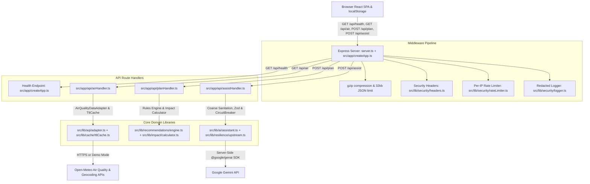

# Architecture Overview

AirAware is a single-service full-stack TypeScript application. In development (`npm run dev`), Express mounts Vite's dev middleware alongside `/api/*` routes. In production (`npm run build && npm start`), Express serves the pre-built static React SPA (`dist/`) and REST API (`dist-server/server.mjs`) from one Node process.

## System Architecture Diagram

## Core Modules & File Paths

- **Server Entrypoint**: `server.ts` (serves Vite middleware in dev; serves `dist/` and `index.html` SPA fallback in `NODE_ENV=production`)
- **App Factory & Middleware**: `src/app/createApp.ts` (`compression`, `trust proxy = 1`, `x-powered-by` disabled, 32kb JSON limit, `/api/health`, `/api/*` routes, 404/500 JSON error handlers)
- **API Handlers**: `src/app/api/airHandler.ts`, `src/app/api/planHandler.ts`, `src/app/api/assistHandler.ts`
- **AQI & Adapters**: `src/lib/aqi/adapter.ts` (`OpenMeteoAdapter`, `DemoAirQualityAdapter`), `src/lib/aqi/bands.ts`, `src/lib/aqi/trend.ts`
- **Recommendations Engine**: `src/lib/recommendations/engine.ts`
- **Impact Calculator & Factors**: `src/lib/impact/calculator.ts`, `src/lib/impact/factors.ts`
- **AI Assistant & Coarse Privacy**: `src/lib/ai/assistant.ts`
- **Cache & Resilience**: `src/lib/cache/ttlCache.ts`, `src/lib/resilience/upstream.ts`
- **Security, Config & Validation**: `src/lib/security/rateLimiter.ts`, `src/lib/security/headers.ts`, `src/lib/security/logger.ts`, `src/lib/config/env.ts`, `src/lib/validation/schemas.ts`
- **Frontend Views & Client Persistence**: `src/App.tsx`, `src/lib/storage.ts`, `src/components/*`, `src/i18n/translations.ts`

## Known Limitations

- **Per-Instance In-Memory State**: `TtlCache` and `PerInstanceIpRateLimiter` live inside Node process memory and reset on restart; horizontal multi-instance scaling does not share cache or rate-limit counters without an external store.
- **No Server Database**: Household profiles live only in browser `localStorage`, preventing cross-device sync.
- **Upstream Dependencies & Free-Tier Quotas**: Live weather/pollution metrics rely on Open-Meteo availability, and AI explanations rely on the configured `GEMINI_API_KEY` and `GEMINI_MODEL` quota tier.
